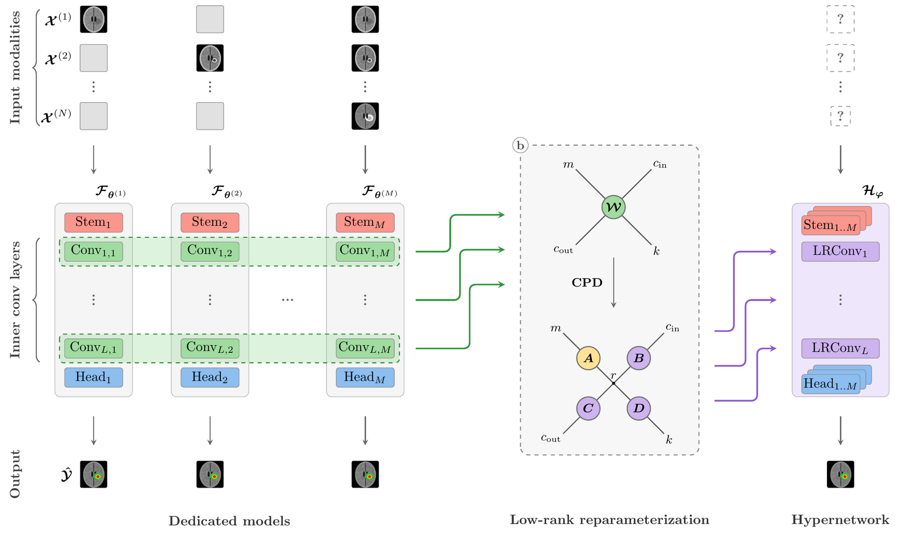
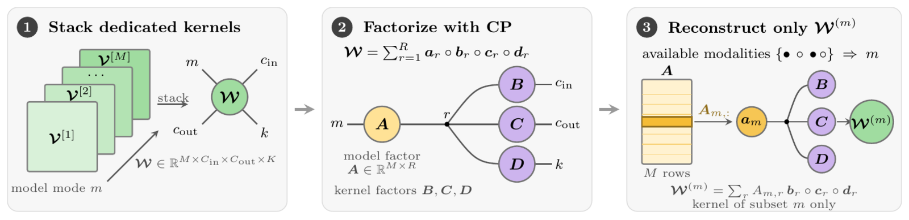
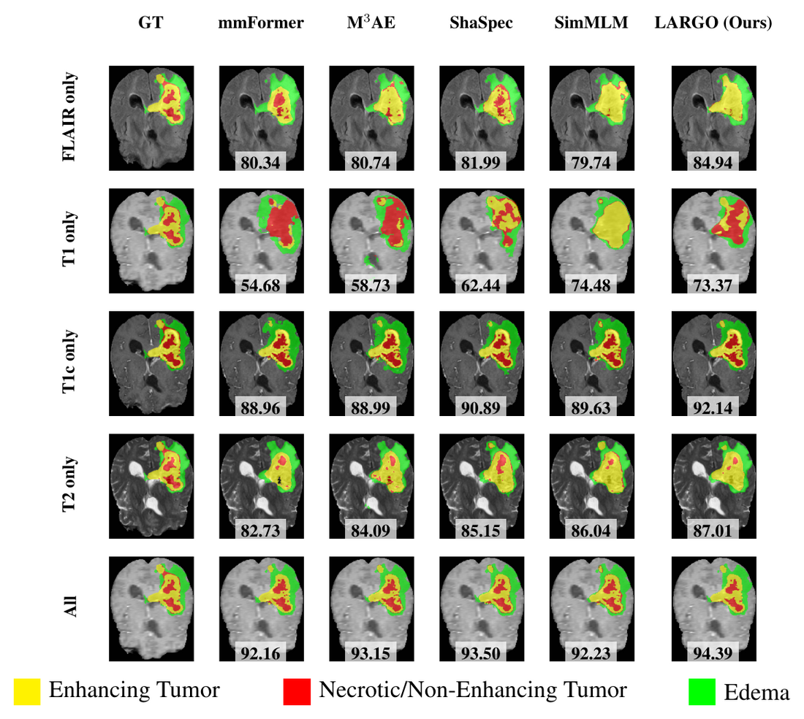

# LARGO: Low-Rank Hypernetwork for Handling Missing Modalities

[](https://arxiv.org/abs/2605.06086)
[](https://neurips.cc/)
[](LICENSE)

Official implementation of **LARGO** (NeurIPS 2026), a hypernetwork that compresses the
2<sup>N</sup> − 1 dedicated missing-modality segmentation networks into a single model with the
parameter budget of one. Given any subset of the N input modalities, LARGO reconstructs the
convolution kernels of the corresponding dedicated network from a shared canonical polyadic (CP)
factorization and runs a standard nnU-Net forward pass.

<p align="center">
  
</p>

**Network level.** The M = 2<sup>N</sup> − 1 dedicated models F<sub>θ<sup>(m)</sup></sub> (one per
modality subset m) share the same architecture. LARGO keeps a small uncompressed stem and head per
subset and replaces every inner convolution by a *low-rank convolution* (LRConv) that holds the
kernels of all M models at once.

<p align="center">
  
</p>

**Layer level.** The kernels of the M models are stacked along a new *model* mode into a tensor
W ∈ ℝ<sup>M×C<sub>in</sub>×C<sub>out</sub>×K</sup>, which is parameterized by its CP factors
A (model), B (input channels), C (output channels) and D (kernel). The factors are trained jointly
from scratch; nothing is decomposed at run time. At inference the available subset m selects the row
A<sub>m,:</sub>, and only the kernel W<sup>(m)</sup> of that subset is reconstructed, so selecting a
model is a constant-time lookup. The rank is chosen such that the whole hypernetwork has the
parameter count of a single nnU-Net (compression ratio 1/M).

## Results

BraTS 2018, 5-fold cross-validation, Dice averaged over the 15 modality subsets and the three tumor
regions. Training time per epoch and GFLOPs are measured on the same hardware with the
full-modality input.

| Model          | Params (M) | Time / epoch | GFLOPs | Avg. Dice (%) ↑  | Speed (vol/s) ↑ |
|----------------|-----------:|-------------:|-------:|:----------------:|----------------:|
| mmFormer       |       36.7 |        2m30s |  138.8 |   73.28 ± 2.31   |            0.89 |
| M³AE           |        2.1 |        1m07s |  333.7 |   74.37 ± 0.99   |            1.02 |
| ShaSpec        |      187.7 |        2m42s | 1411.9 |   75.73 ± 0.89   |            0.68 |
| SimMLM         |        7.8 |        1m12s |  242.1 |   74.59 ± 0.80   |            1.14 |
| **LARGO**      |       22.6 |        1m51s | 1155.1 | **76.41 ± 0.78** |        **1.14** |

LARGO ranks first in 47 of 52 modality configurations over BraTS 2018 (15 subsets × 3 regions) and
ISLES 2022 (7 subsets), and all gains are significant at the patient level. It represents the 15
dedicated nnU-Nets (≈ 338.6M parameters in total) with 22.6M parameters, the budget of a single
nnU-Net (22.57M), at +0.1% parameters and about +25% inference compute and memory for the on-the-fly
kernel reconstruction.

<p align="center">
  
</p>

Qualitative comparison on BraTS 2018 for single-modality inputs and the full input. Yellow:
enhancing tumor, red: necrotic / non-enhancing tumor, green: edema. Numbers are Dice scores.

## Repository layout

The code is organized as a [MONAI bundle](https://docs.monai.io/en/stable/bundle_intro.html):

```
configs/
  train.yaml            training (5-fold CV on BraTS 2018)
  evaluate.yaml         evaluation of a checkpoint on the validation fold
  inference.yaml        prediction on new cases from any modality subset
  train_multigpu.yaml   DistributedDataParallel overrides for train.yaml
  datalist.json         BraTS 2018 cases with fold and validation-subset assignment
  metadata.json         bundle metadata
docs/
  setup.sh, train.sh, train_multigpu.sh, evaluate.sh, inference.sh   convenience / SLURM scripts
  requirements*.txt, data_license.txt, images/
scripts/
  largo/
    cpdconv.py          CPDConv3d / CPDConvTranspose3d: CP-factorized (transposed) convolutions
    network.py          LARGO: nnU-Net (MONAI DynUNet) with low-rank inner layers, per-subset stem and head
    trainer.py          LARGOTrainer: random modality dropout + full-modality guidance (Eq. 5)
    evaluator.py        LARGOEvaluator: evaluation with a fixed or per-case modality subset
  utils/                BraTS label encoding, metrics, checkpoint loading, datalist generation
```

The model itself is self-contained and can be used without the bundle:

```python
import torch
from scripts.largo import LARGO, modality_combinations

net = LARGO(                       # rank=None -> parameter budget of one nnU-Net (22.6M parameters)
    spatial_dims=3, in_channels=4, out_channels=3,
    kernel_size=[3, 3, 3, 3, 3], strides=[1, 2, 2, 2, 2], upsample_kernel_size=[2, 2, 2, 2],
    filters=[32, 64, 128, 256, 512], norm_name="instance", act_name="LeakyReLU", res_block=False,
)
subsets = modality_combinations(4)  # subsets[5] == [0, 2]: FLAIR + T1c
net.set_mod(5)                      # select the dedicated model of this subset
x = torch.randn(1, len(subsets[5]), 128, 128, 128)   # only the available channels are passed
y = net(x)                          # (1, 3, 128, 128, 128): ET, TC, WT logits
```

### Modality subset index

The subsets are ordered by size, then lexicographically, over the channel order
`FLAIR, T1, T1c, T2` (index 0–3). The same index `mod` is used in the datalist, the configs and the
command-line options.

| `mod` | modalities      | `mod` | modalities         | `mod` | modalities              |
|------:|-----------------|------:|--------------------|------:|-------------------------|
|     0 | FLAIR           |     5 | FLAIR, T1c         |    10 | FLAIR, T1, T1c          |
|     1 | T1              |     6 | FLAIR, T2          |    11 | FLAIR, T1, T2           |
|     2 | T1c             |     7 | T1, T1c            |    12 | FLAIR, T1c, T2          |
|     3 | T2              |     8 | T1, T2             |    13 | T1, T1c, T2             |
|     4 | FLAIR, T1       |     9 | T1c, T2            |    14 | FLAIR, T1, T1c, T2      |

## Installation

Python ≥ 3.10 with PyTorch ≥ 2.4, MONAI 1.4 and PyTorch-Ignite 0.5.1. Either install the
requirements directly

```bash
pip install -r docs/requirements_cuda.txt     # or docs/requirements.txt for a CPU-only install
```

or let [`docs/setup.sh`](docs/setup.sh) create a conda environment for you:

```bash
bash docs/setup.sh --device cuda --env largo --python_version 3.12
```

## Data

1. Download the BraTS 2018 training data (285 cases) from the
   [BraTS 2018 challenge](https://www.med.upenn.edu/sbia/brats2018/data.html) (registration
   required) and extract it so that every case is a folder with the four modalities and the
   segmentation:

   ```
   /path/to/brats2018/training/
     Brats18_2013_0_1/
       Brats18_2013_0_1_flair.nii
       Brats18_2013_0_1_t1.nii
       Brats18_2013_0_1_t1ce.nii
       Brats18_2013_0_1_t2.nii
       Brats18_2013_0_1_seg.nii
     ...
   ```

2. [`configs/datalist.json`](configs/datalist.json) ships the exact 5-fold split used in the paper
   (stratified on enhancing-tumor volume) together with the validation subset index `mod` of every
   case, drawn uniformly over the 15 subsets. To regenerate it (it is deterministic and reproduces
   the shipped file):

   ```bash
   python -m scripts.utils.make_datalist --data_dir /path/to/brats2018 --save_path configs/datalist.json
   ```

Please respect the [BraTS data usage agreement](docs/data_license.txt).

## Training

Train one fold with the settings of the paper (750 epochs, SGD with Nesterov momentum, warm-up
cosine schedule, 128³ patches, batch size 1):

```bash
export PYTHONPATH=.
python -m monai.bundle run \
    --config_file configs/train.yaml --meta_file configs/metadata.json --logging_file configs/logging.conf \
    --data_dir /path/to/brats2018/training --fold 0
```

or, equivalently, `bash docs/train.sh --data_dir /path/to/brats2018/training --fold 0`. Each
iteration computes the loss of a random modality subset and of the full input (Eq. 5 of the paper);
with batch size 1 this needs about 7 GB of GPU memory. Options worth knowing:

| option                        | default | meaning                                                                 |
|-------------------------------|---------|-------------------------------------------------------------------------|
| `--fold`                      | 0       | validation fold (0–4)                                                   |
| `--rank`                      | null    | CP rank of all low-rank layers; `null` = rank of Eq. 3 (budget of one nnU-Net) |
| `--checkpoint_kernels true`   | false   | recompute the kernel reconstruction in the backward pass (lower memory) |
| `--batch_size`, `--roi_size`  | 1, 128³ | patch size must be a multiple of 16                                     |
| `--num_epochs`, `--val_interval` | 750, 10 |                                                                      |

Logs, TensorBoard summaries and the checkpoint `model_fold=<k>_checkpoint_epoch=<e>.pt` are written
to `logs/train_fold<k>_<timestamp>/`. Training resumes automatically from `models/model.pt` if that
file exists (`--ckpt_path` to point elsewhere). Validation during training scores every case with
the subset stored in its `mod` field, so the validation Dice is directly comparable to the paper.

Multi-GPU training with DistributedDataParallel:

```bash
bash docs/train_multigpu.sh --data_dir /path/to/brats2018/training --fold 0
```

## Evaluation

Evaluate a checkpoint on its validation fold. Without `--mod`, every case uses its own subset from
the datalist (the protocol of the paper); with `--mod k`, all cases are evaluated with subset `k`:

```bash
python -m monai.bundle run \
    --config_file "['configs/train.yaml','configs/evaluate.yaml']" --meta_file configs/metadata.json \
    --data_dir /path/to/brats2018/training --fold 0 \
    --ckpt_path logs/train_fold0_<timestamp>/model_fold=0_checkpoint_epoch=750.pt [--mod 3] [--save_pred true]
```

or `bash docs/evaluate.sh --data_dir ... --fold 0 --ckpt_path ... [--mod 3]`. Per-case and summary
Dice and 95% Hausdorff distances for ET, TC and WT are written to `logs/eval_fold<k>_mod<m>_<timestamp>/metrics/`;
`--save_pred true` additionally stores the predicted label maps (BraTS classes 1, 2, 4). To obtain
the full table of the paper, loop over the five folds and the 15 subsets:

```bash
for fold in 0 1 2 3 4; do for mod in $(seq 0 14); do
    bash docs/evaluate.sh --data_dir /path/to/brats2018/training --fold $fold --ckpt_path <ckpt of fold $fold> --mod $mod
done; done
```

## Inference on new cases

Segment cases for which only some modalities are available. `--input_dir` contains one folder per
case with files `<case>_flair.nii[.gz]`, `<case>_t1.nii[.gz]`, `<case>_t1ce.nii[.gz]`,
`<case>_t2.nii[.gz]`; only the files of the chosen subset need to exist.

```bash
python -m monai.bundle run \
    --config_file configs/inference.yaml --meta_file configs/metadata.json \
    --input_dir /path/to/cases --ckpt_path models/model.pt --mod 5 --output_dir outputs
```

writes `outputs/<case>_seg.nii.gz` in the geometry of the input images, using FLAIR and T1c only
(`--mod 5`). `bash docs/inference.sh ...` forwards the same arguments.

## Citation

```bibtex
@inproceedings{vyncke2026largo,
  title     = {{LARGO}: Low-Rank Hypernetwork for Handling Missing Modalities},
  author    = {Vyncke, Niels and Ashtari, Pooya and Pi{\v{z}}urica, Aleksandra},
  booktitle = {Advances in Neural Information Processing Systems (NeurIPS)},
  year      = {2026},
  url       = {https://arxiv.org/abs/2605.06086}
}
```

## Acknowledgments

This work is funded by the Flanders AI Research Program (grant no. 174B09119). The computational
resources and services used in this work were provided by the VSC (Flemish Supercomputer Center),
funded by Ghent University, FWO and the Flemish Government, department EWI. The backbone is the
[nnU-Net](https://doi.org/10.1038/s41592-020-01008-z) architecture as implemented in
[MONAI](https://monai.io/).

## License

The code is released under the [MIT License](LICENSE). The BraTS data are subject to their own
[terms of use](docs/data_license.txt). This software is intended for research purposes only and is
not approved for clinical or diagnostic use.
